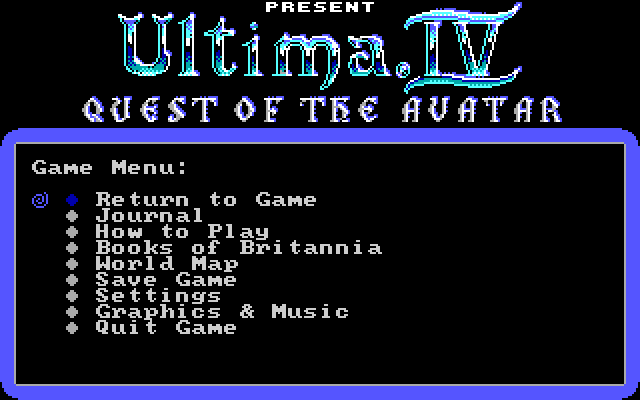
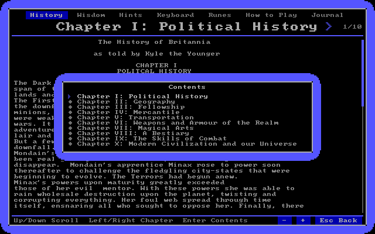
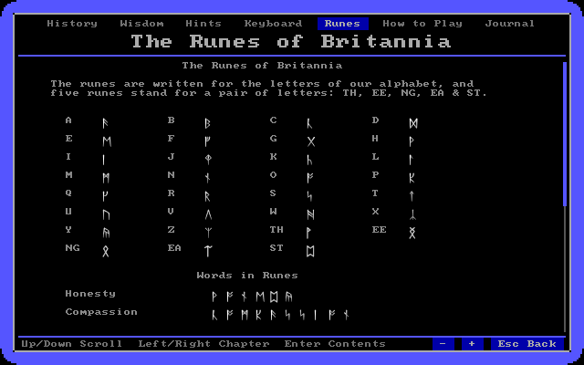
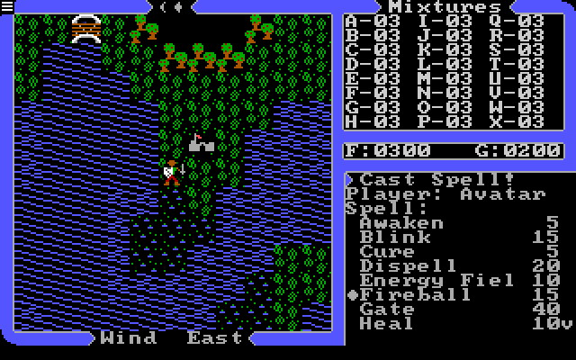
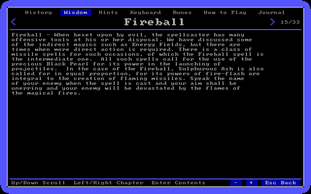
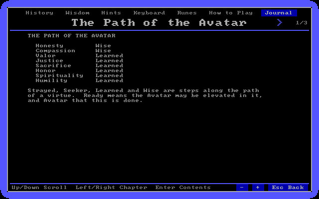
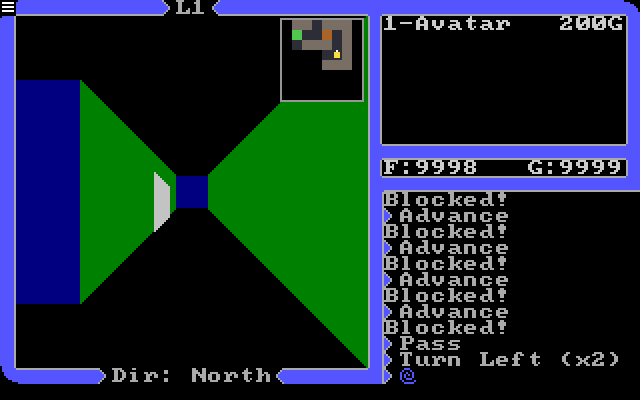
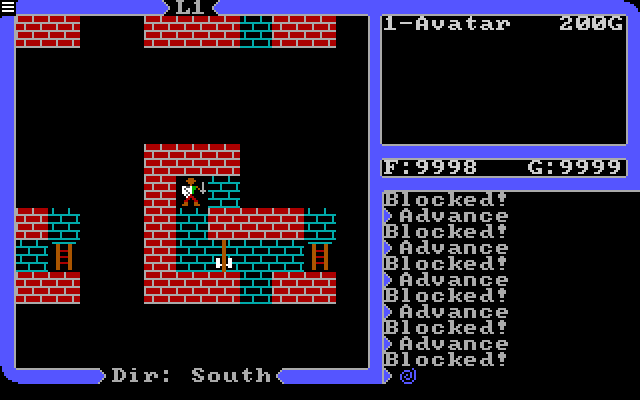
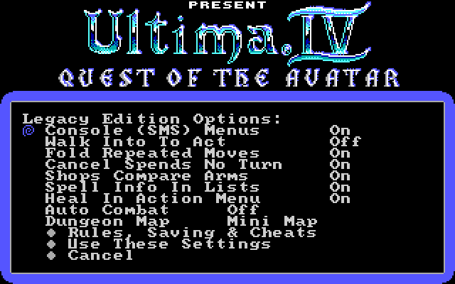
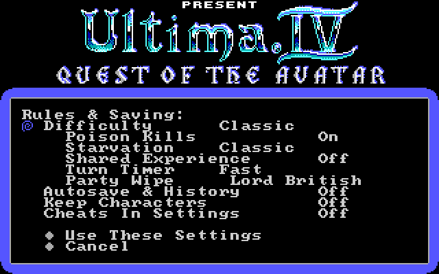

XU4 Legacy Edition
==================

XU4 Legacy Edition is a fork of [XU4], the remake of Ultima IV that runs
the original DOS game data on modern systems.  All credit for XU4 itself
goes to the original XU4 team (see [AUTHORS](AUTHORS)).  Official XU4
releases are on the [XU4 download page], and its development continues
on [Codeberg].

This fork aims to make Ultima IV smoother and easier to get into,
especially for someone who has just downloaded the free release from
[GOG].  Like XU4, it needs the Ultima IV for DOS data files, which are
freeware from [GOG].  No game data is stored in this repository.

What it adds to XU4:

 - [Gamepad, mouse and touch play](#gamepad-mouse-and-touch), with
   console style menus modelled on the Sega Master System version.
 - A [game menu](#the-game-menu) on Escape, drawn like the title menus.
 - The [Books of Britannia](#books-of-britannia) in the game: the
   History, the Book of Mystic Wisdom, the Hints, the reference card, the
   runes, a How to Play guide and a Journal of the quest.
 - A [world map](#world-map) and a [dungeon map](#dungeon-map).
 - [Legacy Edition options](#legacy-edition-options): conveniences,
   difficulty presets, autosave and several characters.
 - [Graphics & music modules](#graphics--music-modules) for the Apple II,
   Commodore 64 and Sega Master System versions, read from your own disk
   images or ROM.
 - [Builds](#installing) for Windows, macOS and Linux, and a Flatpak for
   the Steam Deck.

Features
--------

### Gamepad, Mouse and Touch

The whole game can be played with a gamepad, a mouse or a touch screen.
The **console style menus**, modelled on the Sega Master System version,
replace one key per command with an action menu, list the topics of a
conversation as they are discovered instead of having them typed, and
give pickers for spells, items, numbers and letters.  They switch on by
themselves when a gamepad is used or the screen is tapped, and can be
turned on for keyboard play in Settings > Legacy Edition Options.

Talk topics unlock by the rules of the Master System version: a topic
opens once the right answer, topic or hint has been heard, and hints
from other people are saved with the game.

| In play                | Keyboard            | Gamepad      | Mouse & touch               |
|------------------------|---------------------|--------------|-----------------------------|
| Walk                   | Arrow keys          | Stick, D-pad | Tap beside the party (hold to keep walking, drag to steer) |
| The obvious action (board, klimb, descend...) | Enter | A | |
| Action menu            | Tab                 | X            | Tap the party or the messages |
| Pass a turn            | Space               | B            |                             |
| Party status (Ztats)   | Z                   |              | Tap the party list          |
| World map              | Escape, M           | Y or L       |                             |
| Game menu              | Escape              | Select (View) | The icon in the top left corner |
| Pause                  | Pause               | Start        |                             |

In menus and lists, A or X picks and B backs out, and a tap picks an
item (a tap outside a list cancels).  Direction prompts take a tap
toward the target, and the gypsy's questions a tap on a card.  The
obvious action is XU4's Smart 'Enter' Key; with that option off, Enter
opens the action menu instead.

The letter commands of the original game all still work, and Enter
keeps XU4's behaviour when the console menus are on.  The first time a
gamepad is used, Walk Into To Act and Automatic Actions are switched on
as well, so walking into a door opens it and walking into someone
talks.

### The Game Menu

Escape (Select on a gamepad) opens a menu drawn like the title menus:
Return to Game, Journal, How to Play, Books of Britannia, World Map,
Save Game, Settings, Graphics & Music (the module list) and Quit Game.
Settings can be changed without leaving the game, and Quit Game offers
to save first.

### Books of Britannia

The printed material that came with the game is read inside it.  The
ULTIMA4.TXT file of the GOG release is split into the History of
Britannia, the Book of Mystic Wisdom, the Hints and the player reference
card, and each book is read a chapter at a time (Left/Right, or Enter
for the contents).  The reader also has:

 - **Runes**: the rune for each letter, the combined runes, and some
   words written in runes.
 - **How to Play**: a short guide for new players, from talking to
   people to the quest and the options.
 - **Journal**: the path of each virtue, the quest items found and the
   clues heard.
 - **Three text sizes**: - and + (or the shoulder buttons) change the
   size of the text, which rewraps to fit.

The books also turn up when they are needed: the History of Britannia
is offered when the story asks you to read it, and with Spell Info In
Lists on, ? on a spell or reagent in a list (the right shoulder button,
a right click, or holding it on a touch screen) opens its page of the
Book of Mystic Wisdom.

### World Map

World Map in the game menu (or Y on a gamepad) shows all of Britannia
drawn with the tiles of the chosen module, like the cloth map that came
with the game.  The party is framed in yellow, the moongates are marked
with the moon phase that opens them, and the names written on the cloth
map are shown in runes, or in English with R (Y on a gamepad).  Zoom with
+/- (A, the shoulder buttons, the mouse wheel or a tap) and pan with the
arrows or by dragging.

### Dungeon Map

Dungeons remember the rooms seen.  The Dungeon Map option shows them as
a mini map beside the first person view, or replaces the view with a top
down map.

### Legacy Edition Options

Settings > Legacy Edition Options holds the conveniences of this
edition.  Each can be switched off for the game as it was.

| Option                 | What it does                                       | Starts |
|------------------------|----------------------------------------------------|--------|
| Console (SMS) Menus    | The action menu and pickers described above        | On with a gamepad or a tap |
| Walk Into To Act       | Walking into someone talks, into a foe attacks, into a locked door opens it | On with a gamepad |
| Fold Repeated Moves    | "North (x5)" instead of five lines                 | On     |
| Cancel Spends No Turn  | Backing out of a command costs nothing             | On     |
| Shops Compare Arms     | Shops show how gear compares with what each member has, and offer to equip it | On |
| Spell Info In Lists    | Spell lists show what each spell does and costs, and ? opens its Wisdom page | On |
| Heal In Action Menu    | A Heal or Cure shortcut when someone needs it      | On     |
| Auto Combat            | The party fights on its own                        | Off    |
| Dungeon Map            | Off, Mini Map or Top Down                          | Mini Map |

**Rules, Saving & Cheats** sets the difficulty: Classic is the game as
it was, while Modern and Story are gentler, and each rule can also be
set on its own (whether poison kills, starvation, shared experience, the
turn timer, and whether a fallen party is raised by Lord British or may
reload).  It also turns on autosave with a history of saves to go back
to, several characters each with their own saves, and a Cheats menu.

The Graphics options add Scanlines, a Battery Saver, and Pause Unfocused
(the game waits while its window is in the background).  The video
filter defaults to point scaling, for pixel sharp graphics.

### Graphics & Music Modules

Graphics & Music in the game menu lists the modules in two sections:
Graphics, where one game module is chosen, and Music, where one
soundtrack (or the game's own music) is chosen, so any soundtrack can go
with any graphics.  A module is only listed when the files it needs are
found.  Besides XU4's own Ultima-IV and U4-Upgrade modules, there are:

 - **Apple-II** and **Apple-II-Music**: the title, intro, tiles, font,
   line drawn dungeons, shrine and ending pictures, and the Mockingboard
   music of the Apple II release, read from its disk images (see
   [Apple II Disk Images](#apple-ii-disk-images)).
 - **C64** and **C64-Music**: the title, intro pictures, tiles, font and
   virtue cards, and the SID music of the Commodore 64 release, read from
   its disk images.  **C64-Remastered** uses the art of the Ultima IV
   Remastered fan release (see [C64 Disk Images](#c64-disk-images)).
 - **SMS** and **SMS-Music**: the title, map tiles, font, story pictures,
   the gypsy's cards, the shrine visions and the endgame pictures, and
   the music of the Sega Master System release, read from its ROM (see
   [SMS ROM](#sms-rom)).

The game itself (maps, rules and conversations) stays the DOS one.

The C64 module (top) and the C64-Remastered module (bottom): the title,
the moongate of the intro, the gypsy's cards and the first view of
Britannia.

Getting Started
---------------

### Installing

Every download is on the [releases page].  The game data
(`ultima4.zip`, or the files of the GOG release) goes in one of the
[data folders](#data-folders).

 - **Windows**: unpack the zip anywhere and run `xu4.exe`.  If the GOG
   release is installed in its default folder, it is found by itself.
 - **macOS** (11 or later, Apple Silicon and Intel): open the `.dmg` and
   drag XU4 Legacy to Applications.  Put the game data in
   `~/Library/Application Support/xu4` (in Finder, Go > Go to Folder;
   the folder is made on the first run).  The app is not signed by an
   Apple developer, so the first launch is refused: open System Settings
   > Privacy & Security, scroll down to Security and click Open Anyway
   beside XU4 Legacy.  Or once in Terminal:
   `xattr -dr com.apple.quarantine "/Applications/XU4 Legacy.app"`.
 - **Steam Deck and Linux with Flatpak**: install from the
   [Flatpak repository], which keeps the game up to date like any other
   Flatpak (see [Steam Deck](#steam-deck) below).  From a terminal:

       flatpak install --user https://alexdia25.github.io/xu4-legacy-edition/flatpak/xu4-legacy.flatpakref

   The `.flatpak` file on the releases page is the same build for an
   offline install (`flatpak install --user <file>`), which never
   updates by itself.  Put the game data in `~/.local/share/xu4`.
 - **Other Linux**: the `.deb` package, or the `-linux.tar.gz` archive
   with its `setup` installer.

### Steam Deck

 1. Switch to Desktop Mode (Steam button > Power > Switch to Desktop).
 2. Open the [Flatpak repository] page in a browser and click Install;
    open the downloaded file and Discover installs XU4 Legacy Edition.
    (If Discover asks for a password and the Deck has none, set one in
    Konsole with `passwd`.)
 3. Copy `ultima4.zip` (and any disk images or ROM for the other
    modules) to `~/.local/share/xu4`, in the Dolphin file manager
    (Home, then show hidden files with Ctrl+H).
 4. In Steam, still in Desktop Mode, choose Add a Game > Add a Non-Steam
    Game, tick XU4 Legacy Edition and click Add Selected Programs.
 5. Return to Game Mode.  The game is in the library under Non-Steam.
    The Deck's controls work as a gamepad, which turns on the console
    menus; Quit Game is in the game menu (the View button).

### Data Folders

XU4 Legacy Edition looks for the game data, modules, disk images and ROMs
in the same places as XU4 (listed under Running in the original readme
below), and on Windows also in `C:\GOG Games\Ultima 4 - Quest of the Avatar`,
where the GOG release installs by default.

On macOS the folder is `~/Library/Application Support/xu4`, which also
holds the settings and saved games.

The Flatpak can only see `~/.local/share/xu4` (for the game data, extra
modules, disk images and the SMS ROM) and `~/.config/xu4` (settings and
saved games), so put the files there.

### Apple II Disk Images

The Apple-II module reads its graphics straight from the disk images of
Ultima IV for the Apple II, and the Apple-II-Music soundtrack reads the
Mockingboard tunes from them.  They are only listed in Graphics & Music
when all four disks are found.  The DOS game files are still needed for
everything else.

The release came on two floppy disks, used on both sides, so there are four
disk images:

| Disk side | Contents                          |
|-----------|-----------------------------------|
| Program    | Title screen, intro pictures, tiles & font |
| Britannia  | World map, combat maps & shrines           |
| Towne      | Towns, castles & conversations             |
| Underworld | Dungeons, the Abyss & the ending           |

Each image must be a 140 KB (143,360 byte) file in DOS 3.3 sector order,
which usually has a `.dsk` or `.do` extension.  Images in other formats
(`.po`, `.nib`, `.woz`, `.2mg`) are not read; tools such as CiderPress can
convert them.  Cracked copies such as the 4am crack work.

The file names don't matter, since xu4 tells the disks apart by the files on
them.  Put the four images in any of the [data folders](#data-folders), or in an
`apple2` folder inside one of them.  For example:

 - Windows: `%LOCALAPPDATA%\xu4\apple2\`
 - Linux: `~/.local/share/xu4/apple2/`

Other files that come with the images (text notes, scans, `.woz` copies)
aren't needed.

### C64 Disk Images

The C64 module reads the title screen, intro pictures, tiles, font and
virtue cards straight from the disk images of Ultima IV for the Commodore
64, and the C64-Music soundtrack plays its SID music by running the game's
own music player.  Both need only the Program disk; the dungeons, shrines
and ending still use the DOS pictures.

The C64 release also came on two floppy disks used on both sides (Program,
Britannia, Towne & Underworld), so a full set is four `.d64` images, though
some sets name them "Disk 1" and "Disk 2".  The images are told apart by
their contents, so the file names don't matter, and cracked copies work.
The images must be plain 35 track `.d64` files.

The C64-Remastered module uses the graphics of
[Ultima IV Remastered](https://github.com/MagerValp/u4remastered) 2.2.1 by
Per Olofsson & Vanja Utne: the more colorful tiles and the new intro
pictures and cards.  It reads them from `u4remastered.d81`, or from
`u4remastered-a.d64`.

Put the images in any of the [data folders](#data-folders), or in a `c64` folder
inside one of them, such as `%LOCALAPPDATA%\xu4\c64\` on Windows.  The
modules are only listed in Graphics & Music when their disk images are
found.

### SMS ROM

The SMS module reads the title screen, map tiles, font, story pictures,
the gypsy's abacus & virtue cards, the shrine visions and the pictures of
the end (the Codex, infinity and the stone circle) of Ultima IV: Quest of
the Avatar for the Sega Master System straight from its ROM, and the
SMS-Music soundtrack plays its music by running the game's own sound driver
on a model of the console's Z80 & PSG sound chip.  The dungeons still use
the DOS pictures, and the game itself (maps, dungeons, talk) stays the DOS
one.

The ROM must be the Europe/USA release (512 KB, SHA-1
`a90e21e5961bcf2e10b715a009c04e7c2017a3b1`) with the `.sms` extension; its
file name doesn't matter.  Put it in any of the [data folders](#data-folders), or in
an `sms` folder inside one of them, such as `%LOCALAPPDATA%\xu4\sms\` on
Windows.  The modules are only listed in Graphics & Music when the
ROM is found.  Nothing from the ROM is stored in the modules.

About This Fork
---------------

### Why SDL3 Only

XU4 could be built with several platform layers (GLV, GLFW, Allegro, SDL
1) and used separate libraries for PNG images (libpng) and sound (Faun,
with Ogg Vorbis and PulseAudio).  This fork now uses SDL3 for all of it:
windows, input and gamepads, OpenGL setup, PNG loading and audio.  The
remaining libraries are zlib for reading zip files and Boron, the
scripting language of the game modules.

Why we did this:

 - **Fewer dependencies.**  One library replaces six, so building on a
   new system needs only SDL3, Boron and zlib, and a Windows release ships
   one DLL.
 - **One code path.**  Every feature (gamepads, touch, the console menus)
   only has to be written and tested once, instead of per backend or
   being missing on some.
 - **Checked to behave the same.**  The change was compared against the
   previous version with the replay tests in [tools/test](tools/test):
   scripted play from the title through a town, combat and a dungeon gave
   identical screenshots and save games.

Future benefits:

 - **More platforms.**  SDL3 runs on Windows, macOS, Linux, Android, iOS
   and the Steam Deck, so ports need little more than a build script.
 - **Touch and controllers.**  SDL3's touch, gamepad and on-screen
   keyboard support build on the mouse-only and console menu work.
 - **Easier upkeep.**  Fewer libraries to update, and audio, video and
   input now share one well maintained, widely used project.
 - **Safe big changes.**  The replay tests run on every pull request, so
   later rewrites can be checked against the previous version in the same
   way.

The original XU4 readme follows.

[XU4]: https://xu4.sourceforge.net/
[XU4 download page]: https://xu4.sourceforge.net/download.html
[Codeberg]: https://codeberg.org/xU4/xu4
[GOG]: https://www.gog.com/en/game/ultima_iv_quest_of_the_avatar
[releases page]: https://github.com/alexdia25/xu4-legacy-edition/releases/latest
[Flatpak repository]: https://alexdia25.github.io/xu4-legacy-edition/

XU4
===

> Prepare yourself for a grand adventure: Ultima IV, sixteen times
> larger than Ultima III, is a milestone in computer gaming.  Lord
> British has produced a game to challenge, not only your physical
> and mental skills, but the true fabric of your character.  The evil
> triad of Mondain, Minax, and the hellspawn Exodus, have been
> vanquished and peace reigns throughout the land of Britannia.  Evil
> yet abounds, but in isolated pockets and in the hearts of men.  A
> new age awaits the coming of one who can conquer evil on all
> frontiers through the mastery of both magic and the use of force.
> Daemons, dragons and long-dead wizards still plague the countryside
> and must be destroyed.  The seeker on the path of the avatar will
> faces hostile groups composed of mixed enemy types and will survive
> such encounters only by strategic use of weapons and terrain.
> Earthly victories over seemingly impossible odds lead to the final
> conflict, where the ultimate challenge -- the self -- awaits...
>
>   -- Back cover of Ultima IV box

XU4 is a remake of the computer game Ultima IV.  The goal is to make
it easy and convenient to play this classic on modern operating
systems.  XU4 is primarily inspired by the much more ambitious project
Exult.  Linux is the primary development platform but it gets built
for Windows regularly.  It should be easy to port to any system with
[SDL] 3 support.

XU4 isn't a new game based on the Ultima IV story -- it is a faithful
recreation of the old game, right up to the crappy graphics.  If you
are looking for a game with modern gameplay and graphics, this is not
it -- yet.  New features that improve the gameplay and keep with the
spirit of the original game will be added.

XU4 also tries to maintain strict compatibility with the original for
its savegame files.  You can use a game saved in XU4 with the original
and vice versa, at least in theory.

Status
------

The game is fully playable and can use the original DOS EGA and
upgraded VGA graphics.

Some optional features have been added such as reagent mixing similar to
Ultima 5, speech for non-player characters, and unique spell sounds.

Some thoughts for possible improvements:
 - Ultima 5 style aiming in combat (i.e. allow angle shots)
 - More sound effects
 - Support for higher-resolution tile sets
 - Allow the map view to display more of the world
 - Menu-based interface, like Sega version
 - Use GPU for all rendering.
 - Formal modding system to extend the world or create entirely new adventures.

Compiling
---------

To build the binary on Linux use these commands:

    ./configure
    make

If the required libraries & headers are present, make will create the
executable `src/xu4`.

For more detailed build instructions see [doc/build.md](doc/build.md).

Running
-------

The actual data files from Ultima 4 are loaded at runtime, which means
that a copy of Ultima 4 for DOS must be present.  Fortunately, Ultima IV is
available as closed-source freeware from [www.gog.com].

Some graphics and sounds are stored in module files which have a `.mod`
extension.  Soundtrack modules that only contain music streams are also
available.  One game module and one soundtrack module can be selected using
the Game Module Browser, which is opened with the Escape key.  Modules can be
found on the [XU4 Download] page.

If you have the optional u4upgrad.zip XU4 can read the data files straight
out of the zipfile.  To use it select the U4-Upgrade module.

XU4 searches for data, modules and zipfiles in the following places:
 - The current directory when xu4 is run
 - On Linux: `$HOME/.local/share/xu4`, `/usr/share/xu4` & `/usr/local/share/xu4`
 - On Windows: `%LOCALAPPDATA%\xu4`
 - On macOS: `$HOME/Library/Application Support/xu4` and the app's
   Resources folder

The DOS game zipfiles (ultima4.zip & u4upgrad.zip) don't need to be unpacked,
but if they are the contents may be in a subdirectory named `ultima4` or `u4`.

### Settings & Options

At the title screen, a configuration menu can be accessed by pressing
'c'.  Here, the screen scale, filter, volume and other settings can be
modified.  These settings are stored in `$HOME/.config/xu4/xu4rc` on Linux,
`$HOME/Library/Application Support/xu4/xu4rc` on macOS and
`%APPDATA%\xu4\xu4.cfg` on Windows.

The saved game files are stored in the settings directory.

XU4 also accepts the following command line options:

        --filter <string>   Specify display filtering mode.
                            (point, HQX, xBR-lv2, xBRZ, point-43, xBRZ-43)
    -f, --fullscreen        Run in fullscreen mode.
    -h, --help              Print this message and quit.
    -i, --skip-intro        Skip the intro. and load the last saved game.
    -m, --module <file>     Specify game module (default is Ultima-IV).
    -p, --profile <string>  Use another set of settings and save files.
    -q, --quiet             Disable audio.
    -s, --scale <int>       Specify display scaling factor (1-5).
    -v, --verbose           Enable verbose console output.

### Profiles

Profiles are stored in the `profiles` sub-directory.
Use quotation marks around profile names that include spaces.
The active profile name is shown on the introduction map view off the main menu.

Ultima 4 Documentation
----------------------

Included with Ultima 4 for DOS, as downloaded from one of the above
sites, are electronic copies of the printed documentation from the
original Ultima IV box.  HISTORY.TXT contains the "The History of
Britannia", a general introduction to the world of Ultima IV.
WISDOM.TXT contains "The Book of Mystic Wisdom", which explains the
system of magic and provides descriptions of the spells and reagents.

PDF versions of these books are included in the official download in
the EXTRA folder of the zip file.
As an added bonus this folder also includes a pdf of the offical 
Ultima IV cluebook.

An image of the cloth map from the original Ultima IV box is also
included in the EXTRA folder.

Debug Mode (cheats)
-------------------

XU4 has a very useful debug mode (you can also think of it as a cheat mode).
To enable it:
- press 'c' in the main menu
- make sure that
  1) Game Enhancements = On
  2) Enhanced Gameplay Options -> Debug Mode (Cheats) = On

Cheat list:
* ctrl-c (cheat menu; press one of the following keys to use a cheat)

        1-8   gate (teleports you to a moongate location)
        F1-F8 virtue +10
        a     advance moons (advances the left moon [Trammel] to its next phase)
        c     collision (lets you walk across water, through mountains, etc.)
        e     equipment (gives the party Armour and Weapons)
        f     full stats (gives all party members 50 str, dex & intel and level 8)
        g     goto (enter a location and you will be teleported there)
        h     help (displays list of available cheats)
        i     items (gives the party Items and Equipment)
        j     joined by companions (if eligible)
        k     show karma (shows your virtues)
        l     location (displays current map and coordinates)
        m     mixtures (gives the party 99 mixtures of all spells)
        o     opacity (lets you see through opaque tiles)
        p     peer (switches between normal and gem view)
        r     reagents (gives the party 99 of all reagents)
        s     summon (enter a monster name, and it will appear somewhere nearby)
        t     transports (press b/h/s + arrow key to create a balloon/horse/ship)
        v     full virtues (makes you a full avatar)
        w     change wind (changes or locks the wind direction)
        x     exit map (teleports the party to where it entered the current map)
        y     y-up (like the Y-up spell, but free)
        z     z-down (like the Z-down spell, but free)

* ctrl-d (destroy monster/object; doesn't work on energy fields)
* ctrl-e (end combat)
* ctrl-h (teleport to Lord British's throne room)
* ctrl-v (switch between 3-d and 2-d view; dungeons only)
* F1-F8 (teleport to a dungeon entrance; surface only)
* F9-F11 (teleport to the altar room of truth/love/courage; surface only)
* F12 (display torch duration)

Note:
Except for the ctrl-e command, none of the cheats work during combat.

Misc.
-----

See http://xu4.sourceforge.net/links.html for some other interesting
Ultima IV related links.

Please send an email to wickedsmoke@users.sourceforge.net if you are
interested in helping.

[SDL]: https://www.libsdl.org/
[www.gog.com]: https://www.gog.com/en/game/ultima_iv_quest_of_the_avatar
[XU4 Download]: https://xu4.sourceforge.net/download.html#release
