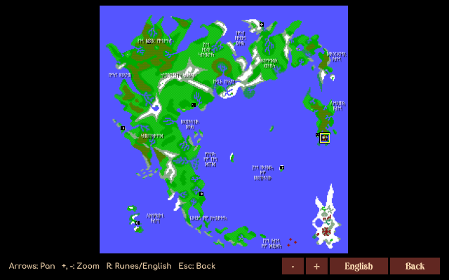
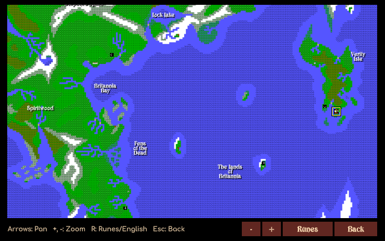
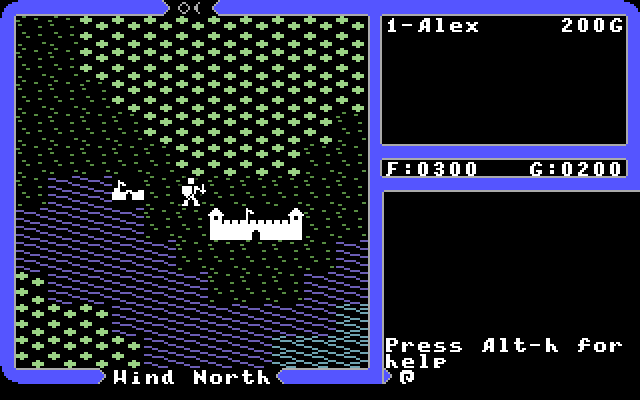
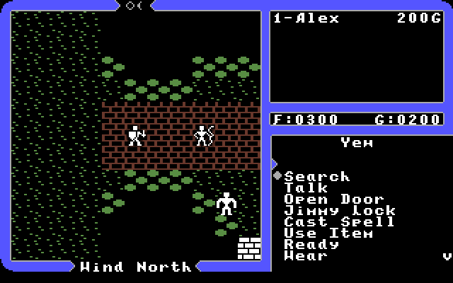
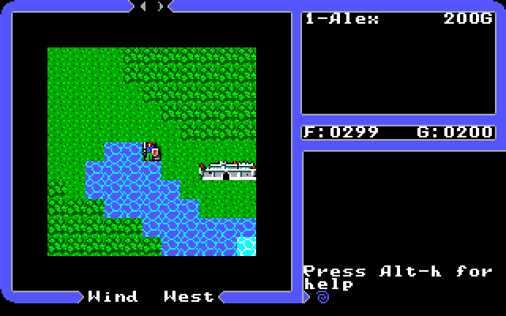
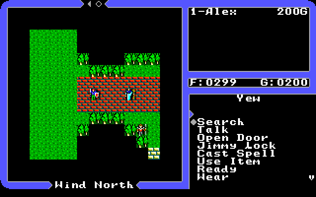

XU4 Legacy Edition
==================

XU4 Legacy Edition is a fork of [XU4], the remake of Ultima IV that runs
the original DOS game data on modern systems.  All credit for XU4 itself
goes to the original XU4 team (see [AUTHORS](AUTHORS)).  Official XU4
releases are on the [XU4 download page], and its development continues
on [Codeberg].

This fork aims to make Ultima IV smoother and easier to get into,
especially for someone who has just downloaded the free release from
[GOG].  Planned and in-progress work:

 - **Controller support.**  A platform independent gamepad layer on
   SDL3, which is now the only platform backend.  The Select (Back, −)
   button opens and closes the game menu, and Start pauses.
 - **Game menu.**  Escape during play opens a menu drawn like the title
   menus: Journal, How to Play, the Books of Britannia, the World Map,
   Save Game, Settings, Graphics & Music (the module list) and Quit
   Game.  The document reader, module list and world map share the look
   of the title menus too, drawn with the game's own font.
 - **Console style menus.**  An optional interface modelled on the Sega
   Master System version: an action menu instead of one key per command,
   conversation topics that are discovered and listed rather than typed,
   and pickers for spells, items, numbers and words, so the whole game
   can be played with a D-pad and two buttons.  It switches on by itself
   when a gamepad is used, or can be turned on for keyboard play with
   Configure > Enhanced Interface Options > Console (SMS) Menus.
 - **Mouse-only and touch play.**  The console menus can also be played
   with just taps (left clicks), as a step towards touch screens: tap
   the map to move toward the tap (hold to keep walking, drag to steer),
   tap your party or the message area for the action menu, tap the party
   list for the Ztats, and tap menu items, letters and numbers to pick
   them (tap outside a list to cancel).  Direction prompts take a tap
   toward the target and the gypsy's questions a tap on a card.  No right
   button or hovering is needed.  The first tap switches the console
   menus on.  The menu icon in the top left corner opens the game menu.
 - **Documents in the game.**  Bringing the out-of-game material (the
   History of Britannia, the Book of Mystic Wisdom, the cloth map) into
   the flow of play, so the game can be played without leaving XU4.
   The ULTIMA4.TXT file of the GOG release is split into separate
   documents, which can be read from Books of Britannia in the game menu.
   Each book is read a chapter at a time (Left/Right, or Enter for the
   contents).  A Runes book shows the rune for each letter and some words
   written in runes, How to Play is a short guide for new players, and
   the Journal keeps the virtues, quest items and clues heard.  The
   reader has three text sizes (- and +, or the shoulder buttons).  The
   History of Britannia is offered when the story asks you to read it,
   and with Spell Info In Lists on, ? (the right shoulder button, a right
   click, or holding it down on a touch screen) on a spell or reagent in
   a list opens its page in the Book of Mystic Wisdom.
 - **World map.**  World Map in the game menu (or the left shoulder
   button on a gamepad) shows all of Britannia drawn with the
   tiles of the chosen module, like the cloth map that came with the game.
   It can also be opened with View Map in the console action menu, and
   the party's position is framed in yellow.  The moongates are marked with the moon phase which opens them, and the
   names written on the cloth map are shown in runes, or in English with
   R (Y on a gamepad).  Zoom with +/- (A/X, the shoulder buttons, the
   mouse wheel or a tap) and pan with the arrows or by dragging.
 - **Pixel-sharp graphics by default.**  The video filter defaults to
   point scaling instead of HQX.
 - **Apple II graphics & music.**  The Apple-II module and Apple-II-Music
   soundtrack read the art and Mockingboard tunes of the Apple II release
   straight from its disk images (see
   [Apple II Disk Images](#apple-ii-disk-images)).
 - **Commodore 64 graphics & music.**  The C64 module and C64-Music
   soundtrack read the art and SID tunes of the C64 release from its disk
   images, and the C64-Remastered module uses the art of the Ultima IV
   Remastered fan release (see [C64 Disk Images](#c64-disk-images)).
 - **Sega Master System graphics & music.**  The SMS module and SMS-Music
   soundtrack read the tiles, font, story pictures, virtue cards and music
   of the Master System release from its ROM (see [SMS ROM](#sms-rom)).
 - **More platforms.**

Like XU4, this fork needs the Ultima IV for DOS data files, which are
freeware from [GOG].  No game data is stored in this repository.

### Game Modules

The module list (Graphics & Music in the game menu) lists the modules
in two sections: Graphics, where one game module is chosen, and Music, where
one soundtrack module (or the game's own music) is chosen.  Space or a click
picks a module and Enter or Play starts with the checked pair.

The Apple-II module uses the graphics of the original Apple II release, and
the Apple-II-Music soundtrack plays its Mockingboard music (see
[Apple II Disk Images](#apple-ii-disk-images) below).  The C64, C64-Music &
C64-Remastered modules do the same for the Commodore 64 release (see
[C64 Disk Images](#c64-disk-images)), and the SMS & SMS-Music modules for
the Sega Master System release (see [SMS ROM](#sms-rom)).  A module is only
listed when the files it needs are found.

### Data Folders

XU4 Legacy Edition looks for the game data, modules, disk images and ROMs
in the same places as XU4 (listed under Running in the original readme
below), and on Windows also in `C:\GOG Games\Ultima 4 - Quest of the Avatar`,
where the GOG release installs by default.

The Flatpak can only see `~/.local/share/xu4` (for the game data, extra
modules, disk images and the SMS ROM) and `~/.config/xu4` (settings and
saved games), so put the files there.

### Apple II Disk Images

The Apple-II module reads its graphics straight from the disk images of
Ultima IV for the Apple II, and the Apple-II-Music soundtrack reads the
Mockingboard tunes from them.  These are only listed in the Game Module
Browser when all four disks are found.  The DOS game files are still needed for
everything else.

The release came on two floppy disks, used on both sides, so there are four
disk images:

| Disk side | Contents                          |
|-----------|-----------------------------------|
| Program    | Title screen, intro pictures, tiles & font |
| Britannia  | World map, combat maps & shrines           |
| Towne      | Towns, castles & conversations             |
| Underworld | Dungeons, the Abyss & the ending           |

Each image must be a 140 KB (143,360 byte) file in DOS 3.3 sector order,
which usually has a `.dsk` or `.do` extension.  Images in other formats
(`.po`, `.nib`, `.woz`, `.2mg`) are not read; tools such as CiderPress can
convert them.  Cracked copies such as the 4am crack work.

The file names don't matter, since xu4 tells the disks apart by the files on
them.  Put the four images in any of the [data folders](#data-folders), or in an
`apple2` folder inside one of them.  For example:

 - Windows: `%LOCALAPPDATA%\xu4\apple2\`
 - Linux: `~/.local/share/xu4/apple2/`

Other files that come with the images (text notes, scans, `.woz` copies)
aren't needed.

### C64 Disk Images

The C64 module reads the title screen, intro pictures, tiles, font and
virtue cards straight from the disk images of Ultima IV for the Commodore
64, and the C64-Music soundtrack plays its SID music by running the game's
own music player.  Both need only the Program disk; the dungeons, shrines
and ending still use the DOS pictures.

The C64 release also came on two floppy disks used on both sides (Program,
Britannia, Towne & Underworld), so a full set is four `.d64` images, though
some sets name them "Disk 1" and "Disk 2".  The images are told apart by
their contents, so the file names don't matter, and cracked copies work.
The images must be plain 35 track `.d64` files.

The C64-Remastered module uses the graphics of
[Ultima IV Remastered](https://github.com/MagerValp/u4remastered) 2.2.1 by
Per Olofsson & Vanja Utne: the more colorful tiles and the new intro
pictures and cards.  It reads them from `u4remastered.d81`, or from
`u4remastered-a.d64`.

Put the images in any of the [data folders](#data-folders), or in a `c64` folder
inside one of them, such as `%LOCALAPPDATA%\xu4\c64\` on Windows.  The
modules are only listed in the Game Module Browser when their disk images
are found.

### SMS ROM

The SMS module reads the title screen, map tiles, font, story pictures,
the gypsy's abacus & virtue cards, the shrine visions and the pictures of
the end (the Codex, infinity and the stone circle) of Ultima IV: Quest of
the Avatar for the Sega Master System straight from its ROM, and the
SMS-Music soundtrack plays its music by running the game's own sound driver
on a model of the console's Z80 & PSG sound chip.  The dungeons still use
the DOS pictures, and the game itself (maps, dungeons, talk) stays the DOS
one.

The ROM must be the Europe/USA release (512 KB, SHA-1
`a90e21e5961bcf2e10b715a009c04e7c2017a3b1`) with the `.sms` extension; its
file name doesn't matter.  Put it in any of the [data folders](#data-folders), or in
an `sms` folder inside one of them, such as `%LOCALAPPDATA%\xu4\sms\` on
Windows.  The modules are only listed in the Game Module Browser when the
ROM is found.  Nothing from the ROM is stored in the modules.

### Screenshots

The DOS graphics with the console style menus: the action menu, and the
topics of a conversation.

The world map with the DOS tiles: all of Britannia with the cloth map's
place names in runes, the moon phase at each moongate, and the party
framed in yellow (on Verity Isle); then zoomed in, with the names in
English.

The Apple-II module, using the tiles of the Apple II release: the
overworld near Britain, and the town of Yew.

The C64 module, using the tiles of the Commodore 64 release: the
overworld near Britain, and the town of Yew.

The C64 module (top) and the C64-Remastered module (bottom): the title,
the moongate of the intro, the gypsy's cards and the first view of
Britannia.

The SMS module, using the tiles of the Sega Master System release: the
overworld near Britain, and the town of Yew.

### Why SDL3 Only

XU4 could be built with several platform layers (GLV, GLFW, Allegro, SDL
1) and used separate libraries for PNG images (libpng) and sound (Faun,
with Ogg Vorbis and PulseAudio).  This fork now uses SDL3 for all of it:
windows, input and gamepads, OpenGL setup, PNG loading and audio.  The
remaining libraries are zlib for reading zip files and Boron, the
scripting language of the game modules.

Why we did this:

 - **Fewer dependencies.**  One library replaces six, so building on a
   new system needs only SDL3, Boron and zlib, and a Windows release ships
   one DLL.
 - **One code path.**  Every feature (gamepads, touch, the console menus)
   only has to be written and tested once, instead of per backend or
   being missing on some.
 - **Checked to behave the same.**  The change was compared against the
   previous version with the replay tests in [tools/test](tools/test):
   scripted play from the title through a town, combat and a dungeon gave
   identical screenshots and save games.

Future benefits:

 - **More platforms.**  SDL3 runs on Windows, macOS, Linux, Android, iOS
   and the Steam Deck, so ports need little more than a build script.
 - **Touch and controllers.**  SDL3's touch, gamepad and on-screen
   keyboard support build on the mouse-only and console menu work.
 - **Easier upkeep.**  Fewer libraries to update, and audio, video and
   input now share one well maintained, widely used project.
 - **Safe big changes.**  The replay tests run on every pull request, so
   later rewrites can be checked against the previous version in the same
   way.

The original XU4 readme follows.

[XU4]: https://xu4.sourceforge.net/
[XU4 download page]: https://xu4.sourceforge.net/download.html
[Codeberg]: https://codeberg.org/xU4/xu4
[GOG]: https://www.gog.com/en/game/ultima_iv_quest_of_the_avatar

XU4
===

> Prepare yourself for a grand adventure: Ultima IV, sixteen times
> larger than Ultima III, is a milestone in computer gaming.  Lord
> British has produced a game to challenge, not only your physical
> and mental skills, but the true fabric of your character.  The evil
> triad of Mondain, Minax, and the hellspawn Exodus, have been
> vanquished and peace reigns throughout the land of Britannia.  Evil
> yet abounds, but in isolated pockets and in the hearts of men.  A
> new age awaits the coming of one who can conquer evil on all
> frontiers through the mastery of both magic and the use of force.
> Daemons, dragons and long-dead wizards still plague the countryside
> and must be destroyed.  The seeker on the path of the avatar will
> faces hostile groups composed of mixed enemy types and will survive
> such encounters only by strategic use of weapons and terrain.
> Earthly victories over seemingly impossible odds lead to the final
> conflict, where the ultimate challenge -- the self -- awaits...
>
>   -- Back cover of Ultima IV box

XU4 is a remake of the computer game Ultima IV.  The goal is to make
it easy and convenient to play this classic on modern operating
systems.  XU4 is primarily inspired by the much more ambitious project
Exult.  Linux is the primary development platform but it gets built
for Windows regularly.  It should be easy to port to any system with
[SDL] 3 support.

XU4 isn't a new game based on the Ultima IV story -- it is a faithful
recreation of the old game, right up to the crappy graphics.  If you
are looking for a game with modern gameplay and graphics, this is not
it -- yet.  New features that improve the gameplay and keep with the
spirit of the original game will be added.

XU4 also tries to maintain strict compatibility with the original for
its savegame files.  You can use a game saved in XU4 with the original
and vice versa, at least in theory.

Status
------

The game is fully playable and can use the original DOS EGA and
upgraded VGA graphics.

Some optional features have been added such as reagent mixing similar to
Ultima 5, speech for non-player characters, and unique spell sounds.

Some thoughts for possible improvements:
 - Ultima 5 style aiming in combat (i.e. allow angle shots)
 - More sound effects
 - Support for higher-resolution tile sets
 - Allow the map view to display more of the world
 - Menu-based interface, like Sega version
 - Use GPU for all rendering.
 - Formal modding system to extend the world or create entirely new adventures.

Compiling
---------

To build the binary on Linux use these commands:

    ./configure
    make

If the required libraries & headers are present, make will create the
executable `src/xu4`.

For more detailed build instructions see [doc/build.md](doc/build.md).

Running
-------

The actual data files from Ultima 4 are loaded at runtime, which means
that a copy of Ultima 4 for DOS must be present.  Fortunately, Ultima IV is
available as closed-source freeware from [www.gog.com].

Some graphics and sounds are stored in module files which have a `.mod`
extension.  Soundtrack modules that only contain music streams are also
available.  One game module and one soundtrack module can be selected using
the Game Module Browser, which is opened with the Escape key.  Modules can be
found on the [XU4 Download] page.

If you have the optional u4upgrad.zip XU4 can read the data files straight
out of the zipfile.  To use it select the U4-Upgrade module.

XU4 searches for data, modules and zipfiles in the following places:
 - The current directory when xu4 is run
 - On Linux: `$HOME/.local/share/xu4`, `/usr/share/xu4` & `/usr/local/share/xu4`
 - On Windows: `%LOCALAPPDATA%\xu4`

The DOS game zipfiles (ultima4.zip & u4upgrad.zip) don't need to be unpacked,
but if they are the contents may be in a subdirectory named `ultima4` or `u4`.

### Settings & Options

At the title screen, a configuration menu can be accessed by pressing
'c'.  Here, the screen scale, filter, volume and other settings can be
modified.  These settings are stored in `$HOME/.config/xu4/xu4rc` on Linux
and `%APPDATA%\xu4\xu4.cfg` on Windows.

The saved game files are stored in the settings directory.

XU4 also accepts the following command line options:

        --filter <string>   Specify display filtering mode.
                            (point, HQX, xBR-lv2, xBRZ, point-43, xBRZ-43)
    -f, --fullscreen        Run in fullscreen mode.
    -h, --help              Print this message and quit.
    -i, --skip-intro        Skip the intro. and load the last saved game.
    -m, --module <file>     Specify game module (default is Ultima-IV).
    -p, --profile <string>  Use another set of settings and save files.
    -q, --quiet             Disable audio.
    -s, --scale <int>       Specify display scaling factor (1-5).
    -v, --verbose           Enable verbose console output.

### Profiles

Profiles are stored in the `profiles` sub-directory.
Use quotation marks around profile names that include spaces.
The active profile name is shown on the introduction map view off the main menu.

Ultima 4 Documentation
----------------------

Included with Ultima 4 for DOS, as downloaded from one of the above
sites, are electronic copies of the printed documentation from the
original Ultima IV box.  HISTORY.TXT contains the "The History of
Britannia", a general introduction to the world of Ultima IV.
WISDOM.TXT contains "The Book of Mystic Wisdom", which explains the
system of magic and provides descriptions of the spells and reagents.

PDF versions of these books are included in the official download in
the EXTRA folder of the zip file.
As an added bonus this folder also includes a pdf of the offical 
Ultima IV cluebook.

An image of the cloth map from the original Ultima IV box is also
included in the EXTRA folder.

Debug Mode (cheats)
-------------------

XU4 has a very useful debug mode (you can also think of it as a cheat mode).
To enable it:
- press 'c' in the main menu
- make sure that
  1) Game Enhancements = On
  2) Enhanced Gameplay Options -> Debug Mode (Cheats) = On

Cheat list:
* ctrl-c (cheat menu; press one of the following keys to use a cheat)

        1-8   gate (teleports you to a moongate location)
        F1-F8 virtue +10
        a     advance moons (advances the left moon [Trammel] to its next phase)
        c     collision (lets you walk across water, through mountains, etc.)
        e     equipment (gives the party Armour and Weapons)
        f     full stats (gives all party members 50 str, dex & intel and level 8)
        g     goto (enter a location and you will be teleported there)
        h     help (displays list of available cheats)
        i     items (gives the party Items and Equipment)
        j     joined by companions (if eligible)
        k     show karma (shows your virtues)
        l     location (displays current map and coordinates)
        m     mixtures (gives the party 99 mixtures of all spells)
        o     opacity (lets you see through opaque tiles)
        p     peer (switches between normal and gem view)
        r     reagents (gives the party 99 of all reagents)
        s     summon (enter a monster name, and it will appear somewhere nearby)
        t     transports (press b/h/s + arrow key to create a balloon/horse/ship)
        v     full virtues (makes you a full avatar)
        w     change wind (changes or locks the wind direction)
        x     exit map (teleports the party to where it entered the current map)
        y     y-up (like the Y-up spell, but free)
        z     z-down (like the Z-down spell, but free)

* ctrl-d (destroy monster/object; doesn't work on energy fields)
* ctrl-e (end combat)
* ctrl-h (teleport to Lord British's throne room)
* ctrl-v (switch between 3-d and 2-d view; dungeons only)
* F1-F8 (teleport to a dungeon entrance; surface only)
* F9-F11 (teleport to the altar room of truth/love/courage; surface only)
* F12 (display torch duration)

Note:
Except for the ctrl-e command, none of the cheats work during combat.

Misc.
-----

See http://xu4.sourceforge.net/links.html for some other interesting
Ultima IV related links.

Please send an email to wickedsmoke@users.sourceforge.net if you are
interested in helping.

[SDL]: https://www.libsdl.org/
[www.gog.com]: https://www.gog.com/en/game/ultima_iv_quest_of_the_avatar
[XU4 Download]: https://xu4.sourceforge.net/download.html#release
